# Looking after the Society's website

A plain-English guide for committee members who update the website. You don't need to know any code.

- **The website:** https://adss-website.pages.dev (moves to the society's own domain at launch)
- **The editor:** add `/admin` to the end of the website address, for example https://adss-website.pages.dev/admin
- **Hosting:** Cloudflare Pages (free). Editors need only a free GitHub account; no Cloudflare or other accounts.

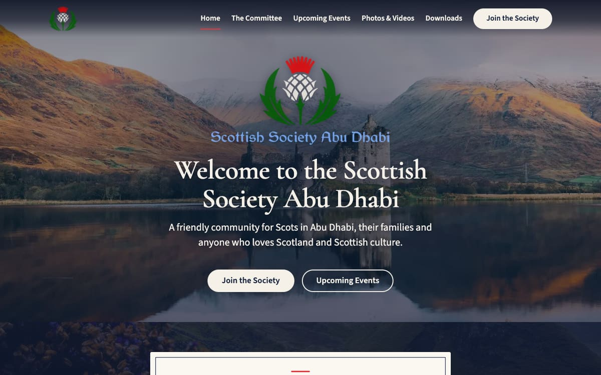

Screenshots of the website show the pre-launch preview, so anything still to be confirmed appears as highlighted **[SQUARE BRACKET]** text.

---

## 1. Getting access (once)

1. Create a free GitHub account at https://github.com/signup if you don't have one.
2. Send your GitHub username to the website owner. They will invite you to the `adss-website` project.
3. Accept the invitation from the email GitHub sends you, or from https://github.com/notifications.
4. Go to the editor (`/admin`), click **Sign in with GitHub**. The first time, GitHub asks you to **Authorize** the Society's sign-in app; click **Authorize**. After that, signing in is one click.

> **The website's project on GitHub is public.** Anyone can read it, including **drafts that haven't been published yet** and the full history of every change. Never put anything in a draft that you wouldn't publish on the website: no personal phone numbers or home addresses, no private email addresses, no unapproved photos, no draft minutes, no passwords or discount codes. If something like that is saved by mistake, tell the website owner straight away, because deleting the draft doesn't remove it from the history.

## 2. How publishing works

Nothing you type goes live until you publish it. Every change goes through three steps:

| Step | What it means |
|---|---|
| **Draft** | Saved, but only visible in the editor. |
| **In review** | Ready for another committee member to check. |
| **Ready** | Approved. The **Publish** button appears. |

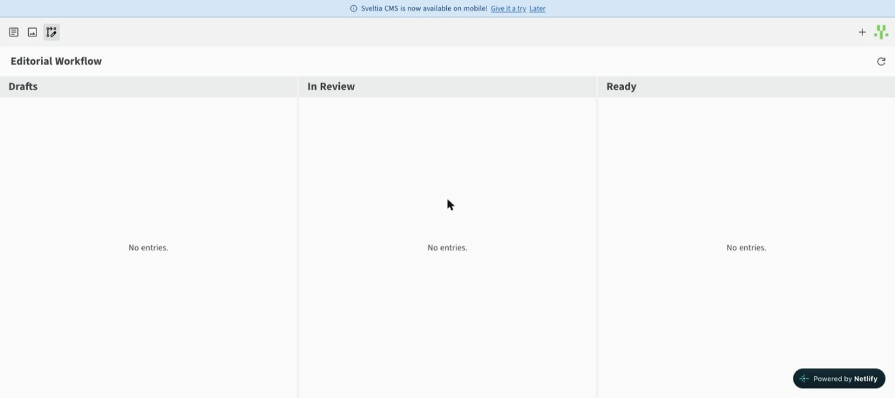

- Click **Save** to create or update a draft. Behind the scenes each draft is kept on its own branch of the GitHub project, and Cloudflare builds a **preview** of the whole website with that draft in it.
- About one to two minutes after saving, **View Preview** at the top of the page opens that preview. Check it there before publishing. Preview addresses end in `.adss-website.pages.dev` and are hidden from search engines.
- Use the **Status** menu to move the change to *In review* or *Ready*, then click **Publish**. Publishing adds the change to the main version of the project, which tells Cloudflare to rebuild the live website; it updates about one to two minutes later.
- The **Workflow** button (the third icon, top left) shows every unpublished change.

**Builds happen one at a time.** Every save and every publish starts a build, and the free hosting builds one at a time (see section 10). If several people save at once, the later previews simply wait their turn.

## 3. Events

On the website, the next event appears on the homepage on a cream card, and every upcoming event is listed on **Upcoming Events**.

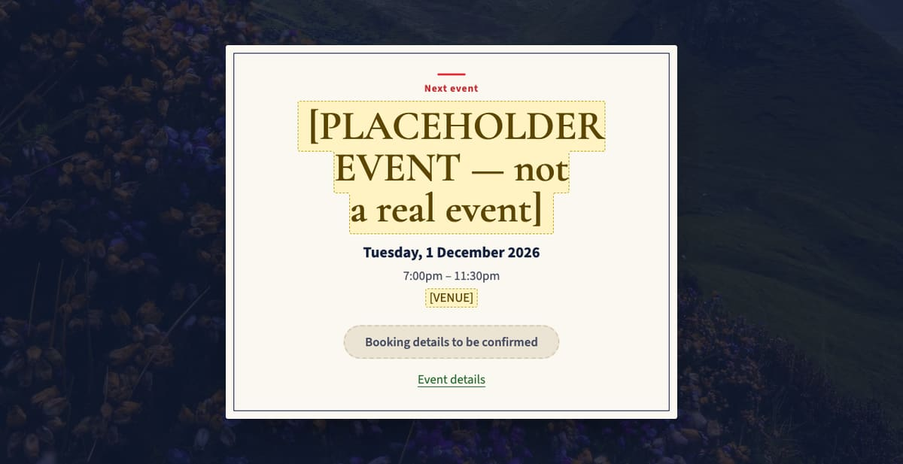

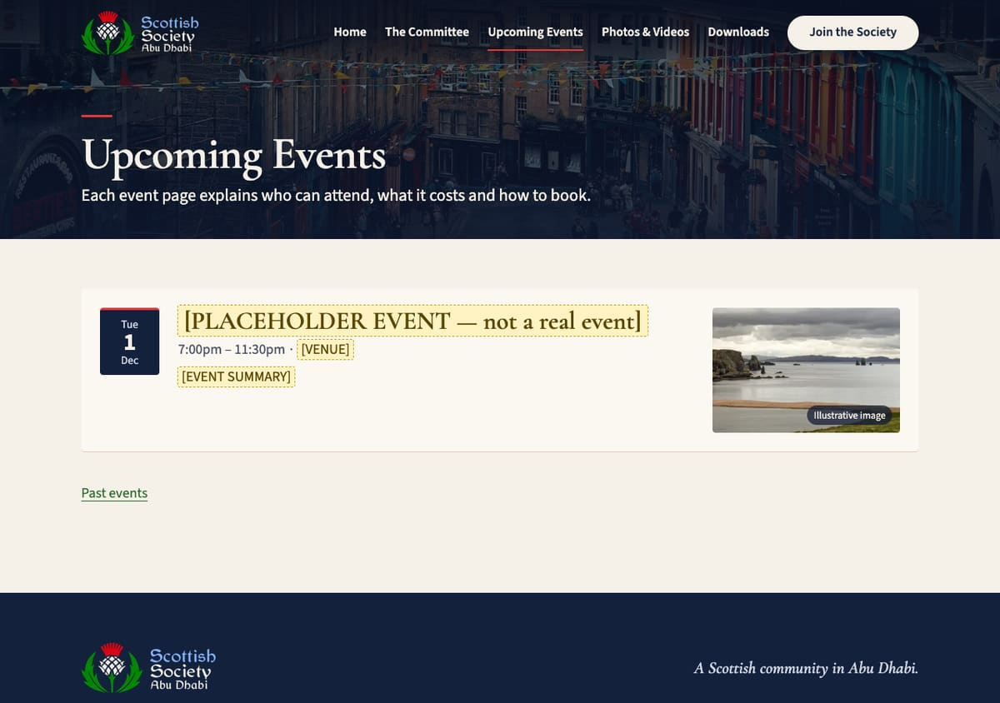

In the editor:

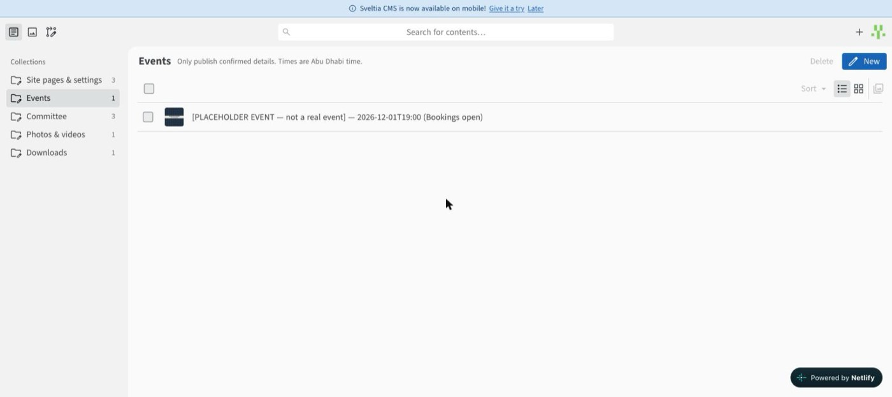

Go to **Events**, then click **New** (or click an existing event to edit it).

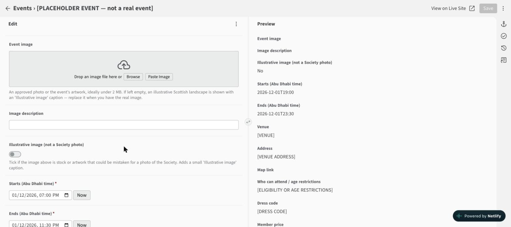

- **Event name**, **Starts** and **Ends** are required. Enter all times as **Abu Dhabi time**.
- The website moves an event to **Past events** by itself once its end time has passed. You don't need to do anything.
- **How to book:** choose *Booking link*, *WhatsApp* or *Email* and fill in the matching box below it. Choose *Not open yet* while booking isn't open; the website then shows "Booking details to be confirmed" instead of a button.
- **Status:** set *Sold out*, *Postponed* or *Cancelled* when that happens. The event stays visible with the status shown, and a postponed or cancelled event is never advertised as the next event.
- After an event, link its photo album with **Photo & video albums**.
- Only publish confirmed details.
- **Event image:** upload the event's photo or artwork. If you leave it empty, the site shows an illustrative Scottish landscape with a small "Illustrative image" caption. If you upload stock or artwork that could be mistaken for a photo of the Society, tick **Illustrative image** so the same caption appears.

## 4. Committee

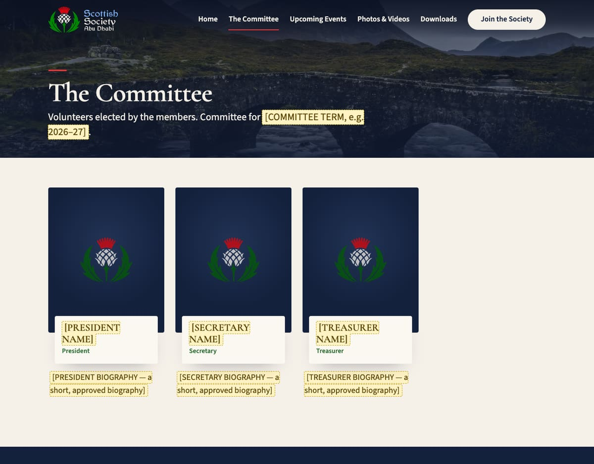

Go to **Committee**. Each person has their own entry.

- **Add someone:** click **New** and fill in name, role, photo and a short biography.
- **Remove someone:** in the Committee list, tick the box next to their entry and click **Delete** (top right).
- **Change the order:** set **Sort order** (lower numbers appear first, e.g. President 10, Secretary 20).
- Use a head-and-shoulders photo of the actual committee member; never a stock photo. The website crops all portraits to the same size.
- No photo yet? Leave the field empty and the website shows a neat tile with the person's initials.
- The committee year shown on the page is set in **Site pages & settings → Contacts, social links & committee term**.

## 5. Photos and videos

Go to **Photos & videos**, then **New** to create an album for an event.

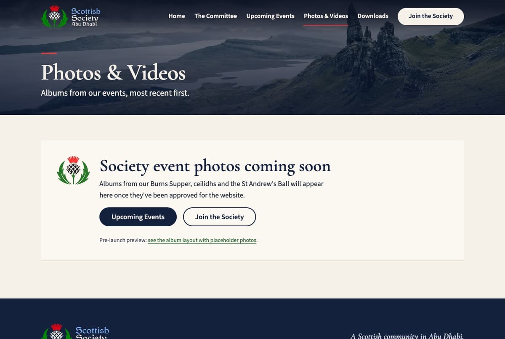

- Choose a **Cover photo**, then add photos one at a time under **Photos**, each with a short **Description** for people who can't see it.
- **Only upload actual photos from that Society event, with approval to publish them.** Never use stock or internet photos in albums.
- If no real album were published, Photos & Videos would show a "Society event photos coming soon" message; the imported albums below mean this no longer applies.
- **Photo size:** aim for **2 MB or less per photo**. The editor shrinks very large photos before saving them, and the website makes smaller versions for phones automatically.
- **Videos:** upload them to YouTube or Vimeo first (unlisted is fine), then paste the link under **Videos**. Videos never play automatically.

### Albums imported from the old website

The five 2024–2025 albums (St Andrew's Ball 2025, May Ceilidh 2025, Six Nations February 2025, Burns Supper 2025 and the St Andrew's Gathering, November 2024) were copied from the old website. Their photos are **not** uploaded through the CMS: they live in the repository under `public/albums/<album>/full/` (large) and `public/albums/<album>/thumb/` (small), already resized, and each album's entry in `src/content/albums/<album>.md` lists them in order with their sizes. Long albums are split into pages of 60 photos on the website.

- These albums can't be edited in the CMS photo list. The title, date and description can.
- **To remove a photo:** delete its two files (`full/NNN.jpg` and `thumb/NNN.jpg`) and the five-line block in the album's `.md` file that points at them (`src`, `thumb`, `width`, `height`, `alt`). Nothing else needs renumbering.
- **To add a photo:** easiest is to ask the website owner, or create a new album in the CMS instead.

## 6. Membership and joining

Go to **Site pages & settings → Membership & joining**.

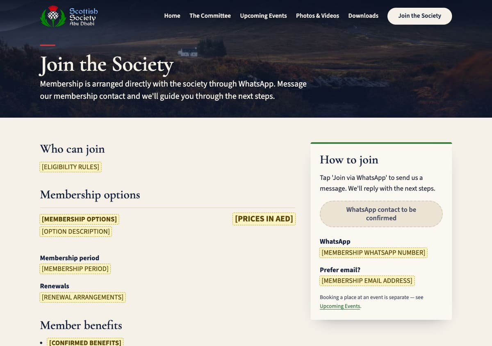

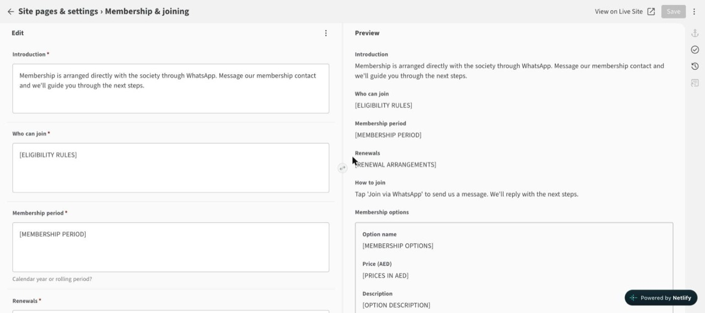

- Edit who can join, the options and prices in AED, the membership period, renewals, benefits and the questions and answers.
- **Membership WhatsApp number:** enter it in international format, e.g. `+971 50 123 4567`. While this field still contains square brackets, the **Join via WhatsApp** button stays switched off and reads "WhatsApp contact to be confirmed".
- Only list partner offers that are current and approved. Discount codes must not go here; they belong in the future members' area.

## 7. Downloads (constitution, minutes, reports)

Go to **Downloads**, then **New**.

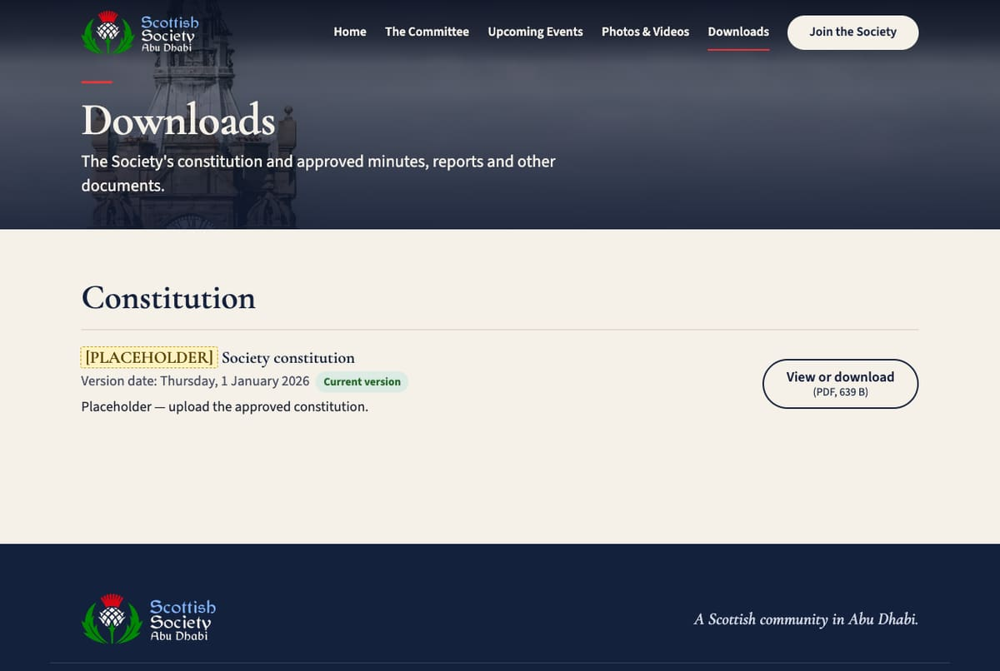

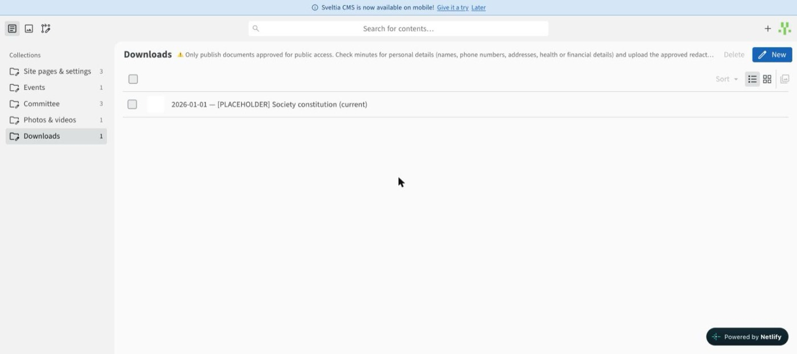

- Upload the PDF, give it a clear title, choose a category and enter the meeting or version date. The website works out the file size itself.
- Tick **Current version** for the current constitution. Older constitutions are automatically labelled "Superseded".
- **Before uploading minutes, check them for personal details** (names, phone numbers, addresses, health or financial information) and upload the approved, redacted version.
- **Replacing a document:** open its entry and click **Replace** under the file. **Removing:** tick the entry in the Downloads list and click **Delete**.

## 8. Homepage, contacts and social links

- **Site pages & settings → Homepage:** the opening photo, welcome text, the "about" text and objectives, and the committee introduction. The opening photo is currently a Scottish landscape (Kilchurn Castle); you can replace it with an approved Society photo. Use a wide, landscape photo, since the middle of it stays visible on phones.
- The photos at the top of the other pages, and behind the next-event card, are fixed decorative Scottish landscapes. Changing them needs the website owner. All are credited in [IMAGE-CREDITS.md](IMAGE-CREDITS.md).
- **Site pages & settings → Contacts, social links & committee term:** the email address, WhatsApp number, phone, address and social media links shown at the bottom of every page.

## 9. Placeholders

Anything in **[SQUARE BRACKETS]** is a placeholder and appears highlighted in yellow on the website. Replace each one with confirmed information. [MISSING-CONTENT.md](../MISSING-CONTENT.md) lists all of them.

## 10. Hosting costs and limits

The website is hosted on **Cloudflare Pages, free plan**, and editors sign in through a small Cloudflare **Worker** (also free). Checked against Cloudflare's documentation on 23 October 2026: [Pages limits](https://developers.cloudflare.com/pages/platform/limits/) and [Workers limits](https://developers.cloudflare.com/workers/platform/limits/).

| Free-plan limit | Allowance | What it means here |
|---|---|---|
| Builds | **500 a month** | Every draft save and every publish is one build. A busy month (say 40 saves and 15 publishes) uses about 55. |
| Builds at once | **1** | Builds queue rather than fail. |
| Build time | **20 minutes** per build | A full build takes about 30 seconds of build time (about one minute end to end). |
| Files | **20,000** per deployment | About 1,400 today, including every photo and resized image. Each new album photo adds two files (full size and thumbnail); each uploaded image adds a few resized copies. |
| File size | **25 MiB** per file | The largest file today is about 0.5 MB. Keep photos under 2 MB, as the editor already advises. |
| Visitor traffic | No bandwidth charge | Unlimited requests for the site's pages and photos. |
| Sign-in Worker | **100,000 requests a day**, 10 ms of CPU each | Each sign-in uses a handful of requests, so this will never be reached. |

**There is no monthly bill and nothing pauses the site.** If the 500 builds ran out in a month, the website would stay online and new changes would wait until the next month; that would take hundreds of saves.

GitHub and Cloudflare are free. The domain renewal is the society's only cost.

## 11. If something goes wrong

- **A published change looks wrong:** edit it again and publish the fix. Every change is kept in GitHub's history, so the website owner can restore any earlier version.
- **Sign-in fails:** check that you accepted the GitHub invitation, then ask the website owner.
- **You published, but the website hasn't changed after five minutes:** the build may be queued behind others, or it failed. The change is saved safely in GitHub either way. Tell the website owner, who can see each build in the Cloudflare dashboard (Workers & Pages → adss-website → Deployments).
- **View Preview doesn't appear:** the preview is still building. Wait a minute and reload the editor.
- **Technical owner tasks** (domain, new editors, launch settings) are in [LAUNCH-CHECKLIST.md](LAUNCH-CHECKLIST.md) and [DECISIONS.md](DECISIONS.md).

## The homepage video

The homepage plays a short silent video loop (`public/video/hero-gala-2025.mp4` and `.webm`) on screens wider than about 48rem; phones and anyone with "reduce motion" turned on see the opening photo instead. To change it, prepare a 15–20 second silent clip under ~6 MB (1440 px wide is plenty), put it in `public/video/`, and set the two "Opening video" fields under Site pages & settings → Homepage. Leave them blank to go back to a still photo.
